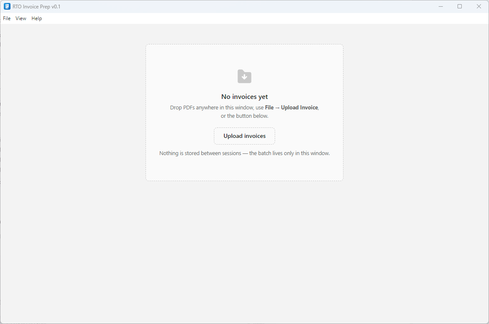
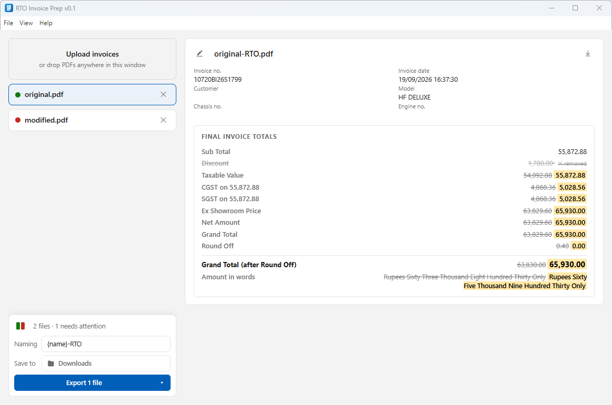

# RTO Invoice Prep

A free Windows app for dealership desks that handle vehicle registration. Open the OEM tax invoice PDF, let the app strike the discount line, and it rewrites the GST breakdown and the amount in words so the RTO copy adds up.

## Download

Grab the latest installer for Windows 10/11 (64-bit) from the
[Releases page](https://github.com/deshmukhmayur/rto-invoice-prep/releases).
No accounts, no servers, no subscriptions — nothing is stored between sessions.

## Documentation

Full docs — getting started, the guide, and FAQ — live on GitHub Pages:
**https://deshmukhmayur.github.io/rto-invoice-prep/**

## What it does

- **Strikes the dealer discount** — along with its share of taxable value, CGST, and SGST.
- **Rewrites totals and round-off**, recomputed at the GST rates printed on the invoice itself.
- **Rewrites the amount in words** in Indian numbering for the new grand total.
- **Leaves everything else untouched** — chassis, engine, HSN, dealer details, taxes actually collected.
- **Refuses what it doesn't understand** — template variants are rejected, never guessed at. Invoices with no discount line are handed back as-is.
- **Local first** — invoices never leave your computer; the only network activity is a release-update check.

| First launch | Verifying a batch |
| --- | --- |
|  |  |

## Development

Requires [Bun](https://bun.sh) and Node/Electron.

```sh
bun install        # install dependencies
bun run dev:browser  # serve the renderer in a plain browser (mocked API)
bun start          # build and launch the Electron app
bun run typecheck  # tsc --noEmit
bun run dist       # build the Windows installer
```

## License

MIT — see the `license` field in `package.json`.

---

<p align="center">
  Developed with <a href="https://opencode.ai">opencode</a> using the
  <a href="https://z.ai">GLM-5.3-Flash</a> model.
</p>
